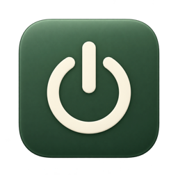
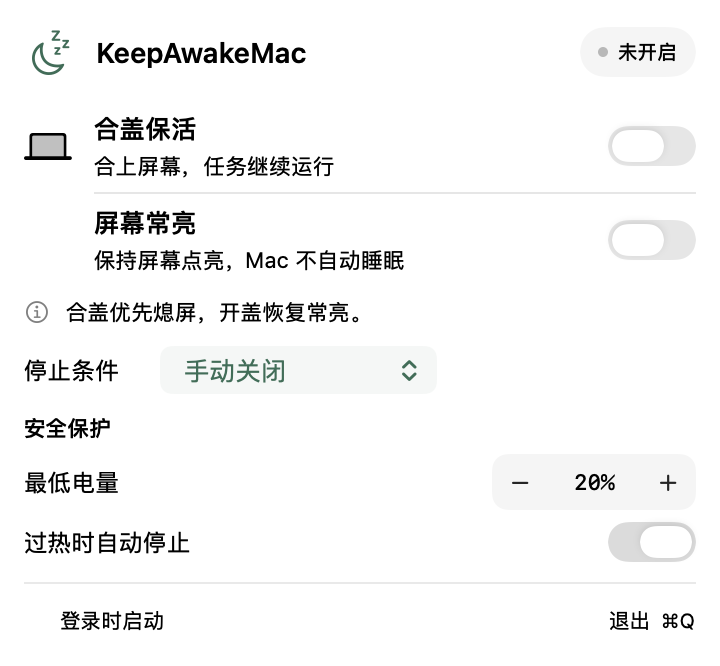

<p align="center">
  
</p>

<h1 align="center">KeepAwakeMac</h1>
<p align="center">合上屏幕，任务继续。任务结束，恢复休眠。</p>
<p align="center">A native macOS menu bar utility for keeping your Mac awake until the work is done.</p>
<p align="center">
  <a href="https://github.com/WdBlink/KeepAwakeMac/actions/workflows/build.yml"></a>
  <a href="LICENSE"></a>
</p>

KeepAwakeMac 面向 **Apple Silicon MacBook**，提供合盖保活、屏幕常亮，以及 Codex、Claude Code、mcode 指定任务结束后的自动停止。使用 SwiftUI 和原生控件，没有第三方运行时依赖。macOS 26 及以上使用 Apple 的 Liquid Glass，较早系统沿用标准菜单材质；启用“减少透明度”或“增强对比度”时使用实色背景。菜单按内容收紧，高度超出屏幕时才滚动。

**当前为早期源码版本。** 最低构建目标是 macOS 13；当前实机验证环境为 Apple Silicon / macOS 27.0。尚无签名公证的安装包、Homebrew 安装入口或 Mac App Store 版本。其他系统版本和机型需要验证。

<p align="center">
  
</p>
<p align="center"><sub>真实 SwiftUI 视图的离屏布局预览，使用测试数据和中性底色；实际菜单的毛玻璃透色由 macOS 渲染，此处不是实机截图。</sub></p>

## 能做什么

| 模式 | 开盖时 | 合盖时 | 权限 |
| --- | --- | --- | --- |
| 合盖保活 | 允许屏幕按系统设置熄灭 | 系统继续运行，并请求内置和外接显示器休眠 | 需要批准后台服务 |
| 屏幕常亮 | 阻止闲置熄屏与系统闲置睡眠 | 释放屏幕常亮请求；单独使用时不保证合盖保活 | 无需管理员权限 |
| 两者同时开启 | 屏幕和系统保持唤醒 | **合盖熄屏优先**，开盖后恢复屏幕常亮请求 | 需要批准后台服务 |

- 两个开关独立控制；关闭其中一个不会关闭另一个。
- 停止条件包括手动、1–24 小时倒计时、指定 Agent 任务完成、指定应用退出、拔掉电源适配器。
- 自动停止同时关闭两种保活。后开启第二个开关不会重置倒计时。
- 最低电量可设为 5–80%；过热保护在系统报告 `critical` 时停止。无法读取电池状态时也会停止。
- 保活期间锁定停止条件和保护设置；两个开关都关闭后可调整。

合盖保活会改变系统级睡眠设置。请保持通风，勿把仍在运行的 MacBook 放入背包，也不要同时运行其他合盖保活工具。电量与温度保护不能替代正常散热。

## 从源码安装

需要完整的 **Xcode 26 或更新版本**（包含 Liquid Glass SDK）、XcodeGen，以及能运行该 Xcode 的 macOS。运行时最低目标仍为 macOS 13。仅安装 Command Line Tools 不足以构建 App。

```bash
git clone https://github.com/WdBlink/KeepAwakeMac.git
cd KeepAwakeMac
brew install xcodegen
export DEVELOPER_DIR=/Applications/Xcode.app/Contents/Developer
xcodegen generate
xcodebuild -project KeepAwakeMac.xcodeproj -scheme KeepAwakeMac \
  -configuration Debug -derivedDataPath build \
  ENABLE_HARDENED_RUNTIME=NO CODE_SIGN_IDENTITY=- build
```

构建产物：`build/Build/Products/Debug/KeepAwakeMac.app`。

先退出正在运行的旧版本，再安装并启动：

```bash
ditto build/Build/Products/Debug/KeepAwakeMac.app /Applications/KeepAwakeMac.app
open /Applications/KeepAwakeMac.app
```

这是本机 ad-hoc 签名构建，不是适合公开分发的安装包。替换构建后，macOS 可能要求重新批准后台服务。请从 `/Applications` 启动，保持安装位置稳定。

## 第一次使用

1. 点击菜单栏的月亮图标，选择停止条件、电量下限和温度保护。
2. 只需要开盖常亮时，开启 **屏幕常亮** 即可。
3. 需要合盖继续工作时，开启 **合盖保活**。出现权限提示后，点击旁边的箭头进入系统设置，在 **通用 → 登录项与扩展 → 后台 App 活动** 中允许 KeepAwakeMac，按系统要求完成管理员认证。不同 macOS 版本的栏目名称可能不同。
4. 返回 App，再次开启合盖保活。开关确认开启才表示后台服务已确认成功。
5. 使用完关闭开关或退出 App，恢复正常睡眠。关闭屏幕常亮会释放保活请求，之后按系统设置自动熄屏，不会立即强制黑屏。

### 等待 Agent 任务结束

在 **停止条件 → Agent 任务完成** 中选择 Agent，刷新列表，选择一个正在运行的任务，再开启需要的保活开关。

| Agent | 本地状态来源 | 完成依据 |
| --- | --- | --- |
| Codex | `~/.codex/sessions` | `task_complete` |
| Claude Code | `~/.claude/projects` | `turn_duration`，且无待完成后台 Agent / workflow |
| MiniMax Code / mcode | `~/.minimax/v2/sqlite/runtime-state.sqlite` | 所选会话从 `started` 转为 `idle` |

每 2 秒检查一次，连续两次确认结束后停止。工具调用、等待批准和暂时无输出都不视为完成。任务中止、失败或状态无法读取时也会停止，并显示对应原因。

这里只跟踪**所选任务的本轮运行**，不代表整个项目已完成，也不覆盖远程任务、其他会话或外部后台命令。扫描最多 100 个最近会话；被强制结束却没有终止记录的会话可能仍出现在列表。适配基于本机 Codex 记录、Claude Code 2.1.282、mcode 0.5.3；记录格式变化、自定义数据目录和旧版 mcode 数据库暂不保证兼容。

## 常见问题

**为什么不能直接用 `caffeinate` 实现合盖保活？**

普通闲置保活请求和合盖睡眠是不同路径。本项目通过经批准的 root helper 调用 `pmset -a disablesleep 1/0` 控制合盖保活。`disablesleep` 并非 Apple 承诺兼容的公开接口，不能保证未来系统行为；需要在目标机型验证。

**屏幕会一直保持关闭吗？**

合盖保活期间，确认合盖后约 1 秒请求一次显示器休眠，包含外接屏幕。外部键鼠等后续输入仍可能唤醒显示器；本工具不拦截这些唤醒事件。

**提示需要后台权限或电源设置超时？**

确认 App 位于 `/Applications`，并已允许后台活动；展开错误详情查看原因。系统繁忙时操作可能超时，可以稍后重试。本机重新构建后如服务仍指向旧版本，参见[开发与排障](docs/DEVELOPMENT.md)。不要通过关闭 SIP 或全局关闭 Gatekeeper 来解决。

**“指定应用退出”能监控任意命令吗？**

不能。它监视 `NSWorkspace` 可见的图形应用名称或 Bundle ID。CLI Agent 请使用专门的 Agent 任务选项。

**如何退出与卸载？**

关闭两个保活开关，确认没有恢复睡眠失败的提示，再点“退出”。在系统设置中关闭 KeepAwakeMac 的后台活动与登录项，然后将 `/Applications/KeepAwakeMac.app` 移到废纸篓。退出会释放本 App 的电源请求；异常退出另有 helper 恢复机制。

**异常退出后仍无法睡眠？**

helper 会监视 App 退出，并在失去心跳约 20 秒后尝试恢复；重启 helper 时也会检查恢复标记。如果这些恢复失败，先退出其他保活工具，再手动恢复：

```bash
sudo pmset -a disablesleep 0
```

此命令改变全系统设置，仅用于确认异常后的恢复。实现边界见[安全说明](SECURITY.md)。

## 隐私与验证范围

App 不收集遥测、不上传任务内容、不安装 Agent hooks，也不修改 Agent 配置。任务检测在本机只读访问日志或数据库；错误信息可能包含本地路径，提交 Issue 前请脱敏。

自动检查覆盖 XPC 超时与拒绝、状态回退、两种模式互不误关、合盖优先熄屏、任务完成判断、恢复标记和安全阈值；这些检查使用模拟电源操作。已在开发机验证过合盖保活、原生屏幕保活请求，以及较早构建的真实 helper 开关与退出恢复。**当前组合版本的物理合盖、持续熄屏及重新授权后的完整流程仍需实机验收。** CI 与界面预览不能替代这些检查。

## 开发与贡献

```bash
# 模拟回归检查：不会修改实际睡眠设置
bash scripts/check-helper.sh
# 10 种界面状态的离屏渲染检查
bash scripts/check-menu.sh /tmp/keepawakemac-menu-previews
```

项目结构、诊断命令和贡献约定见[开发说明](docs/DEVELOPMENT.md)；安装包发布条件见[发布清单](RELEASE_CHECKLIST.md)。欢迎提交可复现的 [Issue](https://github.com/WdBlink/KeepAwakeMac/issues) 或小范围 PR。涉及提权、签名或任务数据泄露的问题请使用[私密安全报告](SECURITY.md)。

## 许可与致谢

代码与随附图标资源采用 [MIT License](LICENSE)。图标由生成式图像工具辅助制作，已导出为原生 macOS 图标资源。

README 的组织参考了 [KeepingYouAwake](https://github.com/newmarcel/KeepingYouAwake) 的简洁安装与能力边界说明，以及 [Lunar](https://github.com/alin23/Lunar) 的图标和界面展示方式。未复用它们的代码或图片。Codex、Claude Code 和 MiniMax Code 是各自项目的名称；本项目与这些产品无官方关联。
